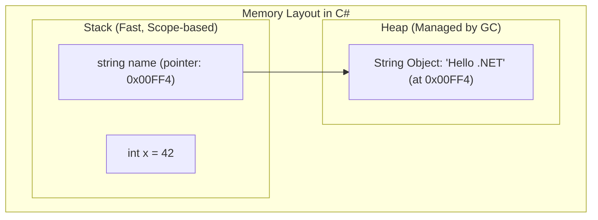

# Part 01: C# Fundamentals - From Zero to Hero

Welcome to **Part 01** of the comprehensive .NET & C# Mastery Course. In this module, you will master the foundational pillars of C# and the .NET runtime.

---

## 📚 What You Will Learn

1. **The .NET Architecture & CLI basics**: How CLR (Common Language Runtime) executes IL (Intermediate Language).
2. **Value Types vs. Reference Types**: Deep dive into the Stack vs. the Heap.
3. **Type Conversions & Safe Parsing**: Implicit vs. explicit casting and `TryParse`.
4. **Modern Null Safety**: `Nullable<T>`, `?`, `??`, `??=`, and `?.`.
5. **Control Flow & Pattern Matching**: Switch expressions with relational, type, and tuple patterns.
6. **Method Parameter Modifiers**: `in`, `out`, `ref`, and `params`.

---

## 🧠 Core Theoretical Concepts

### 1. Value Types vs. Reference Types

| Characteristic              | Value Types (`struct`, `int`, `double`, `bool`) | Reference Types (`class`, `string`, arrays, objects)    |
| :-------------------------- | :------------------------------------------------------ | :---------------------------------------------------------- |
| **Storage**           | Typically allocated on the **Stack**              | Storage allocated on the **Heap**; reference on Stack |
| **Assignment**        | Deep copy of the actual binary value                    | Shallow copy of the memory pointer                          |
| **Default Value**     | `0`, `false`, or default bitwise zero               | `null`                                                    |
| **Garbage Collector** | Automatically freed when leaving scope                  | Tracked & collected by the Garbage Collector (GC)           |



---

### 2. Modern Null Handling in C#

Null reference exceptions are one of the most common bugs in software engineering. Modern C# provides first-class null-safety operators:

```csharp
string? maybeName = null;      // '?' indicates nullable reference

// 1. Fallback default with ??
string displayName = maybeName ?? "Guest";

// 2. Assign if currently null with ??=
maybeName ??= "DefaultUser";

// 3. Safe navigation with ?.
int? length = maybeName?.Length;
```

---

### 3. Switch Expressions with Pattern Matching

Unlike legacy `switch-case` statements, modern C# supports concise pattern-matching expressions:

```csharp
int score = 85;
string grade = score switch
{
    >= 90 => "A",
    >= 80 and < 90 => "B",
    >= 70 and < 80 => "C",
    _ => "F" // discard / default
};
```

---

### 4. Interactive Real-World Example: Product Billing & Tiered Discounts

This module includes an interactive practical console invoice calculator demonstrating user input, safe cultural parsing, and tiered conditional logic:

```csharp
using System;
using System.Globalization;

Console.Write("Enter product name: ");
string productName = Console.ReadLine() ?? "";

Console.Write("Enter quantity: ");
int qty = int.Parse(Console.ReadLine() ?? "0");

Console.Write("Enter unit price: ");
double price = double.Parse(Console.ReadLine() ?? "0", CultureInfo.InvariantCulture);

double subtotal = qty * price;
double discountRate = 0.0;

// Tiered conditional discount
if (qty > 100)
{
    discountRate = 0.20; // 20% discount
}
else if (qty > 50)
{
    discountRate = 0.10; // 10% discount
}
else if (qty >= 20)
{
    discountRate = 0.05; // 5% discount
}

double discountAmount = subtotal * discountRate;
double finalAmount = subtotal - discountAmount;

Console.WriteLine("\n-----------------------------");
Console.WriteLine($"Product:         {productName}");
Console.WriteLine($"Quantity:        {qty}");
Console.WriteLine($"Unit Price:      ${price:F2}");
Console.WriteLine($"Subtotal:        ${subtotal:F2}");
Console.WriteLine($"Discount ({discountRate * 100:0}%): -${discountAmount:F2}");
Console.WriteLine($"Total Amount:    ${finalAmount:F2}");
Console.WriteLine("-----------------------------");
```

#### Key Concepts Demonstrated:

1. **`CultureInfo.InvariantCulture`**: Ensures floating-point numbers parse with period `.` regardless of whether the operating system uses commas `,` (like in Germany, France, or Vietnam).
2. **`?? ""` (Null-Coalescing)**: Protects against null inputs from `Console.ReadLine()`.
3. **Format Specifiers**:
   - `${price:F2}`: Formats to 2 fixed decimal places.
   - `${discountRate * 100:0}%`: Formats discount percentage as a clean integer without trailing zeros.

---

### 5. Interactive Real-World Example: Full Console Calculator

A multi-operation interactive calculator handling user validation loops, custom operator parsing, and arithmetic error handling:

```csharp
using System;
using System.Globalization;

bool keepRunning = true;

while (keepRunning)
{
    // 1. Get first number with validation loop
    double num1 = ReadDouble("Enter first number: ");

    // 2. Validate operator (+, -, *, /, %, ^)
    char op = ReadOperator();

    // 3. Get second number with validation loop
    double num2 = ReadDouble("Enter second number: ");

    // 4. Calculate result with error checking
    double? result = Calculate(num1, num2, op);

    // 5. Display result
    if (result.HasValue)
    {
        Console.WriteLine($"Result: {num1} {op} {num2} = {result.Value:G10}");
    }

    // 6. Loop control
    Console.Write("Do another calculation? (y/n): ");
    string answer = Console.ReadLine()?.Trim().ToLowerInvariant() ?? "";
    if (answer != "y" && answer != "yes")
    {
        keepRunning = false;
    }
}
```

#### Key Architecture Lessons:

1. **Validation Loops (`while (true)`)**: Re-prompts the user immediately when invalid numeric input or unsupported operators are entered instead of terminating.
2. **Nullable Return (`double?`)**: Returns `null` when a math error occurs (like division by zero or modulo by zero) so the caller can handle it gracefully.
3. **Exponentiation**: Uses `Math.Pow(a, b)` for power `^` operations.
4. **General Format Specifier (`:G10`)**: Formats numbers cleanly without trailing zeroes while supporting scientific precision.

---

## 🚀 How to Run This Project

Navigate to this folder and execute using the .NET CLI:

```bash
cd 01-csharp-fundamentals
dotnet run
```

### Expected Output Preview:

- Detailed breakdown of value type copying vs reference pointer mutation.
- Demonstration of explicit casting and safe `TryParse`.
- Safe null operator evaluations.
- Evaluated switch expression and tuple pattern results.
- Demonstrations of `out`, `ref`, and `params` methods.

---

## 📝 Practice Exercises

1. Modify `Program.cs` to write a method `bool IsValidEmail(string? input, out string domain)` that validates basic email structure and extracts the domain part.
2. Implement a `switch` expression that takes a 2D coordinate `(int x, int y)` and returns the quadrant: `"Origin"`, `"Q1"`, `"Q2"`, `"Q3"`, or `"Q4"`.
