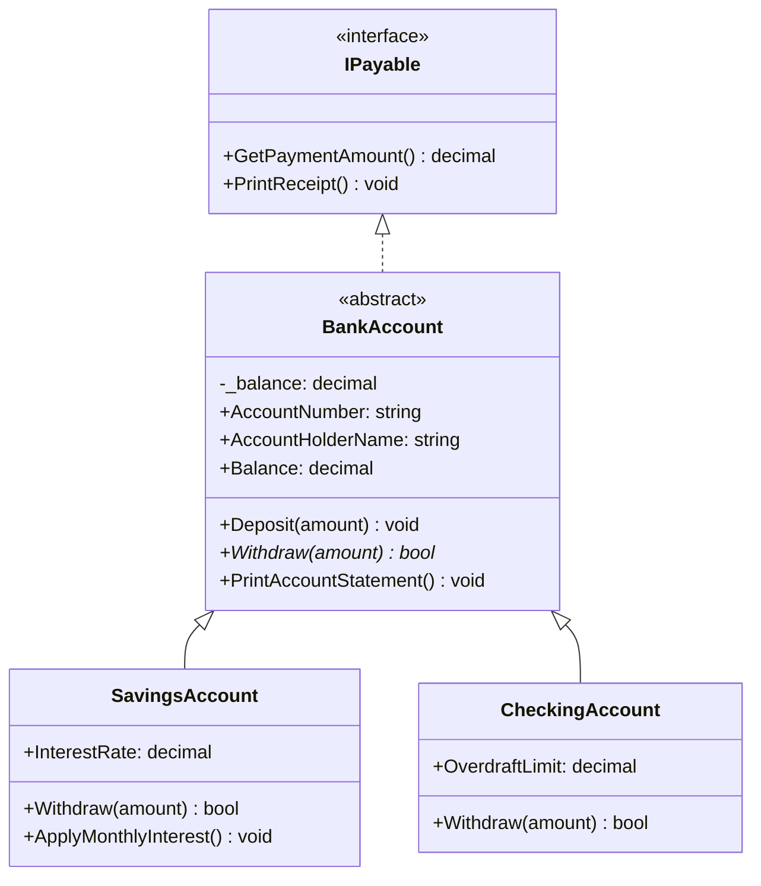

# Part 02: Object-Oriented Programming (OOP) Deep Dive

Welcome to **Part 02** of the course. In this module, you will transition from procedural fundamentals to advanced, idiomatic Object-Oriented Programming in C#.

---

## 📚 What You Will Learn
1. **The Four Pillars of OOP**:
   - **Encapsulation**: Private state protection, properties (`init`, `required`).
   - **Abstraction**: `abstract` classes and interfaces.
   - **Inheritance**: Code reuse via base classes (`base()`, `protected`).
   - **Polymorphism**: Dynamic method dispatch via `virtual` and `override`.
2. **Interfaces**:
   - Standard interface contracts.
   - **Default Interface Methods (DIM)**: Introducing default behavior without breaking existing implementers.
   - **Explicit Interface Implementation**: Disambiguating methods when two interfaces share identical signatures.
3. **Class vs. Struct vs. Record**:
   - Reference equality vs. value equality.
   - Positional records with auto-generated equality and `ToString()`.
   - Non-destructive mutation with the `with` keyword.

---

## 🧠 Core Theoretical Concepts

### 1. Class vs. Struct vs. Record Comparison

| Feature | `class` | `struct` | `record` (class/struct) |
| :--- | :--- | :--- | :--- |
| **Type Category** | Reference Type (Heap) | Value Type (Stack/Inline) | Reference (default) or Value (`record struct`) |
| **Equality Check** | Reference Equality by default (`c1 == c2` checks memory addresses) | Value Equality (reflection-based unless overridden) | **Value Equality** (synthesized by compiler) |
| **Inheritance** | Single class inheritance supported | No inheritance (interfaces only) | Inherits from other records only |
| **Immutability & Mutation** | Mutable by default | Mutable unless marked `readonly` | Immutable by default (`init`), supports `with` |
| **Best Used For** | Complex entities with identity and lifecycle | Small, short-lived mathematical types (Vectors, Points) | Data Transfer Objects (DTOs), API models, immutable domain states |

---

### 2. Polymorphic Class Hierarchy



---

### 3. Explicit Interface Implementation
When a class implements two interfaces that declare a method with the exact same name and parameters, explicit interface implementation resolves the collision:

```csharp
public class CheckingAccount : INotificationTarget, IAuditLogTarget
{
    // Accessible only when cast to INotificationTarget
    void INotificationTarget.SendAlert(string message) { ... }

    // Accessible only when cast to IAuditLogTarget
    void IAuditLogTarget.SendAlert(string message) { ... }
}
```

---

## 🚀 How to Run This Project

```bash
cd 02-oop-deep-dive
dotnet run
```

---

## 📝 Practice Exercises
1. Add a new subclass `CertificateOfDepositAccount` (CD Account) that locks withdrawals until a specified maturity date.
2. Create an interface `ITaxReportable` with method `decimal CalculateTaxableInterest()` and implement it on `SavingsAccount`.
3. Use a positional record to model an `OrderTransaction` with properties `OrderId`, `Amount`, `Timestamp`, and demonstrate updating its status using `with`.
