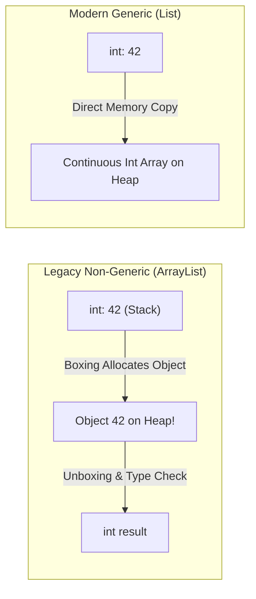

# Part 03: Generics, Collections, and LINQ

Welcome to **Part 03** of the course. In this module, you will master type safety, high-performance data structures, and fluent data querying using LINQ.

---

## 📚 What You Will Learn
1. **Generics & Type Constraints**:
   - Why generics eliminate boxing/unboxing overhead.
   - Constraint types: `where T : class`, `struct`, `notnull`, `new()`, `IComparable<T>`.
2. **Modern .NET Collections**:
   - `List<T>`, `Dictionary<TKey, TValue>`, `HashSet<T>`.
   - `PriorityQueue<TElement, TPriority>` (min-heap priority queue).
3. **LINQ (Language Integrated Query)**:
   - **Deferred Execution** vs **Immediate Execution**.
   - Filtering: `Where`, `Take`, `Skip`.
   - Projections: `Select`, `SelectMany` (flattening nested hierarchies).
   - Grouping & Aggregations: `GroupBy`, `Sum`, `Average`, `Count`.
   - Relational operations: `Join` between disconnected datasets.

---

## 🧠 Core Theoretical Concepts

### 1. Boxing vs Generics (Performance & Memory)
Without generics (e.g. `System.Collections.ArrayList`), value types had to be boxed into objects on the heap, triggering continuous GC allocations.



### 2. LINQ Deferred Execution vs Immediate Execution
- **Deferred (`IEnumerable<T>`)**: The query definition does not execute until it is iterated over (via `foreach`, `ToList()`, `First()`, etc.).
- **Immediate**: Operators like `ToList()`, `ToArray()`, `Count()`, `Sum()` force immediate query materialization into memory.

```csharp
// Deferred: No CPU work done yet
var query = products.Where(p => p.Price > 100);

// Immediate: Evaluated, filtered, and saved in RAM
List<Product> list = query.ToList();
```

---

## 🚀 How to Run This Project

```bash
cd 03-generics-collections-linq
dotnet run
```

---

## 📝 Practice Exercises
1. Write a LINQ query to find the **top 2 most expensive products** in each category.
2. Given a list of integers with duplicates, use `HashSet<int>` or LINQ `Distinct()` to find duplicates without sorting.
3. Use `Aggregate` to generate a single comma-separated string of product names costing under $100.
