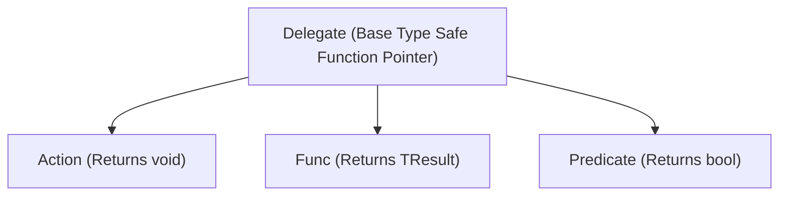

# Part 04: Modern C# Features & Functional Concepts

Welcome to **Part 04** of the course. In this module, you will dive into modern C# functional idioms, delegates, events, pattern matching, and extension methods.

---

## 📚 What You Will Learn
1. **Delegates & Lambdas**:
   - `Action<T>` (returns `void`) vs. `Func<T, TResult>` (returns a value).
   - **Closures**: How lambdas capture outer scope variables and memory implications.
2. **Events & Publisher-Subscriber Pattern**:
   - Safe event raising with `?.Invoke(this, args)`.
   - Weak event patterns and preventing memory leaks.
3. **Modern Pattern Matching**:
   - Property patterns (`{ Role: "Admin", Level: >= 5 }`).
   - Relational and logical patterns (`and`, `or`, `not`).
   - **List Patterns** (`[first, .., last]`).
4. **Extension Methods**:
   - Extending classes without inheritance or source code modification.

---

## 🧠 Core Theoretical Concepts

### 1. Delegates vs Func vs Action



### 2. List Patterns (C# 11+)
Pattern match directly on array or list elements:

```csharp
string Describe(int[] numbers) => numbers switch
{
    [] => "Empty array",
    [var only] => $"Exactly one element: {only}",
    [1, 2, .. var rest] => $"Starts with 1, 2, then has {rest.Length} more items",
    [var first, .., var last] => $"Starts with {first} and ends with {last}",
    _ => "Other array"
};
```

---

## 🚀 How to Run This Project

```bash
cd 04-modern-csharp-features
dotnet run
```

---

## 📝 Practice Exercises
1. Write an extension method `string MaskCreditCard(this string cardNumber)` that replaces all but the last 4 digits with asterisks.
2. Implement a list pattern matcher for a command-line parser that accepts `["git", "commit", "-m", var message]` and extracts the commit message.
3. Create a `StockTicker` publisher class that fires a `PriceChanged` event whenever a stock's price moves by more than 5%.
