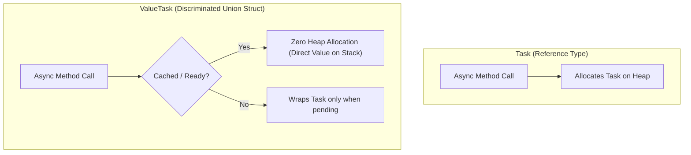

# Part 05: Asynchronous Programming & Concurrency

Welcome to **Part 05** of the course. In this module, you will master non-blocking I/O, concurrency primitives, thread safety, and modern asynchronous streams.

---

## 📚 What You Will Learn
1. **The Async/Await State Machine**:
   - How the C# compiler transforms async methods into a state machine.
   - The role of `Task` vs `ThreadPool`.
2. **Task vs ValueTask**:
   - Why `ValueTask<T>` eliminates GC allocations on synchronous cached paths.
3. **Cooperative Cancellation**:
   - `CancellationTokenSource` and passing `CancellationToken` through all I/O calls.
4. **Concurrency Control & Thread-Safety**:
   - `SemaphoreSlim` for rate-limiting concurrent external requests.
   - Lock-free atomic synchronization with `Interlocked`.
5. **Asynchronous Streams**:
   - `IAsyncEnumerable<T>`, `yield return`, and `await foreach`.

---

## 🧠 Core Theoretical Concepts

### 1. Task vs ValueTask Allocation
- A `Task<T>` is a reference type allocated on the managed heap. If an API returns cached data synchronously millions of times, allocating a `Task` object each time burdens the Garbage Collector.
- `ValueTask<T>` is a value type (`struct`). If the result is already available, no heap allocation occurs.



### 2. Synchronization Primitives Comparison

| Primitive | Use Case | Async-Friendly? |
| :--- | :--- | :--- |
| `lock(object)` | Fast in-memory protection of shared state | ❌ Cannot `await` inside a `lock` block! |
| `SemaphoreSlim` | Throttling concurrency or async critical sections | ✅ `await semaphore.WaitAsync()` |
| `Interlocked` | Atomic increments, exchanges (`Increment`, `CompareExchange`) | ✅ Blazing fast, lock-free CPU instructions |

---

## 🚀 How to Run This Project

```bash
cd 05-async-and-threading
dotnet run
```

---

## 📝 Practice Exercises
1. Write a resilient parallel web scraper simulator using `SemaphoreSlim` to limit concurrent requests to 3, with a 5-second overall cancellation timeout.
2. Implement a producer-consumer pipeline using `System.Threading.Channels.Channel<T>`.
3. Create an `IAsyncEnumerable<int>` that yields Fibonacci numbers with a 100ms delay between elements, supporting cancellation.
