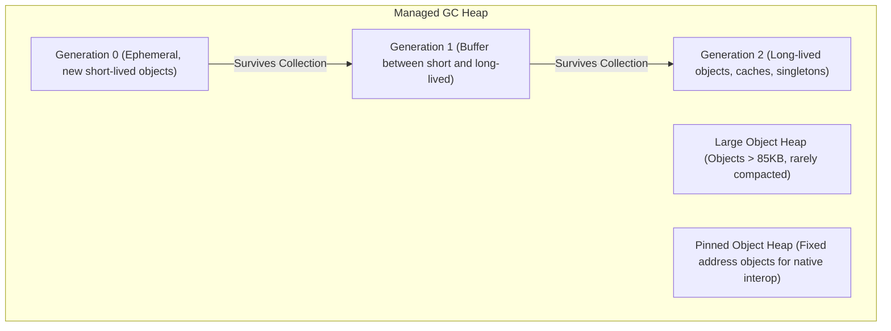

# Part 06: Memory Management, Performance & Span<T>

Welcome to **Part 06** of the course. In this module, you will dive into the low-level runtime mechanics of .NET, learning how to write high-throughput, low-latency, and zero-allocation C# code.

---

## 📚 What You Will Learn
1. **Garbage Collection (GC) Internals**:
   - Generations 0, 1, 2, Large Object Heap (LOH > 85,000 bytes), and Pinned Object Heap (POH).
   - GC compaction, pauses, and memory pressure.
2. **Deterministic Cleanup & `IDisposable`**:
   - The standard dispose pattern, `GC.SuppressFinalize()`, and `using` statements.
3. **`Span<T>` & `ReadOnlySpan<T>`**:
   - Contiguous memory representation over stack, heap, and native memory.
   - Slicing strings and byte buffers with **zero heap allocations**.
4. **`ArrayPool<T>`**:
   - Reusing large arrays from shared memory pools to prevent LOH fragmentation.
5. **`stackalloc` & `ref struct`**:
   - Stack memory allocation for micro-optimizations and compiler safety constraints.

---

## 🧠 Core Theoretical Concepts

### 1. The Generational Garbage Collector



### 2. Traditional Slicing vs `Span<T>` Slicing

| Feature | `string.Substring()` | `ReadOnlySpan<char>` |
| :--- | :--- | :--- |
| **Heap Allocation** | Allocates a **new string object** on Heap | **Zero** heap allocation |
| **GC Pressure** | Generates garbage for every substring | Zero GC overhead |
| **Performance** | O(N) memory copy | O(1) pointer + length slice |
| **Limitation** | None (can be stored on heap fields) | `ref struct`: cannot be boxed or placed in fields of normal classes |

---

## 🚀 How to Run This Project

```bash
cd 06-memory-and-performance
dotnet run
```

---

## 📝 Practice Exercises
1. Write a CSV line parser using `ReadOnlySpan<char>` that splits columns without allocating any `string` instances until output is needed.
2. Implement a `ValueStringBuilder` (or examine standard .NET 9+ `SearchValues<T>`) to search for forbidden characters in strings efficiently.
3. Benchmark parsing 100,000 dates using `DateTime.Parse(span)` vs `DateTime.Parse(string)` and inspect GC collection counts.
