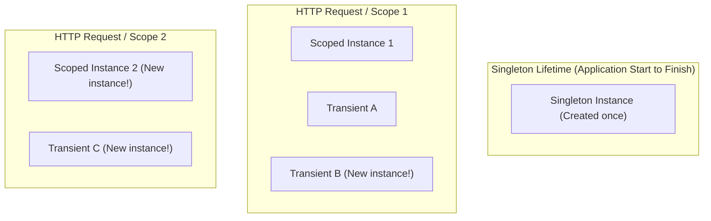

# Part 07: Dependency Injection, Configuration & Logging

Welcome to **Part 07** of the course. In this module, you will master enterprise application architecture using the modern .NET Generic Host, Dependency Injection (IoC), hierarchical configuration, and structured logging.

---

## 📚 What You Will Learn
1. **The .NET Generic Host (`HostApplicationBuilder`)**:
   - Application lifecycle, configuration loading, service registration.
2. **Dependency Injection (DI) Lifetimes**:
   - `Transient`: Created every time requested.
   - `Scoped`: Created once per client request / scope (e.g., per HTTP request).
   - `Singleton`: Single shared instance created once across the entire application.
   - **The Captive Dependency Anti-Pattern**: Why injecting a Scoped service into a Singleton creates subtle memory and concurrency bugs.
3. **Hierarchical Configuration & Options Pattern**:
   - Layered configuration sources (`appsettings.json`, environment variables).
   - Strongly-typed `IOptions<T>`.
4. **Structured Logging (`ILogger<T>`)**:
   - Why you must **never** use string interpolation in logging (`$"Order {id}"` vs `"{OrderId}"`).
   - Queryable semantic log properties.

---

## 🧠 Core Theoretical Concepts

### 1. DI Service Lifetimes Visualized



### 2. Service Lifetime Decision Matrix

| Lifetime | When to Use | Examples |
| :--- | :--- | :--- |
| **`Transient`** | Lightweight, stateless operations, safe for multithreading | Math calculators, formatting helpers, short-lived domain validators |
| **`Scoped`** | Stateful operations tied to a single unit of work | EF Core `DbContext`, User Session, Unit of Work |
| **`Singleton`** | Expensive to initialize, caches, application-wide state | In-memory cache, HTTP client factories, configuration readers |

---

## 🚀 How to Run This Project

```bash
cd 07-di-configuration-logging
dotnet run
```

---

## 📝 Practice Exercises
1. Introduce an `appsettings.Development.json` file that overrides `PaymentGateway:EnableSandbox` to `false`, and run the app with `DOTNET_ENVIRONMENT=Development`.
2. Demonstrate how `IOptionsSnapshot<T>` allows reading updated configuration values on every scope without restarting the host.
3. Write a custom Hosted Service (`IHostedService` or `BackgroundService`) that periodically logs memory usage every 2 seconds.
