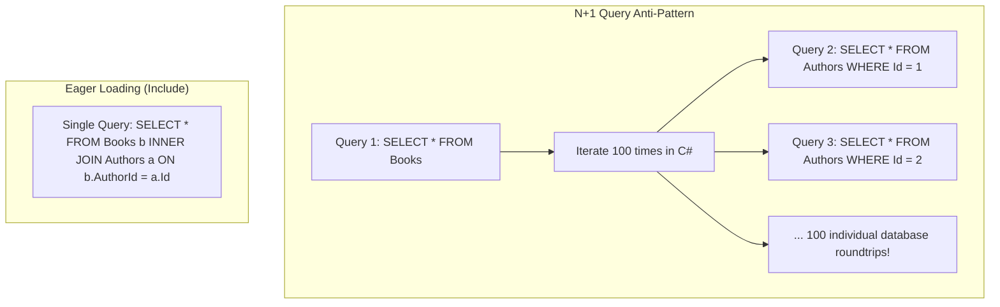

# Part 08: Entity Framework Core (EF Core) Mastery

Welcome to **Part 08** of the course. In this module, you will master Object-Relational Mapping (ORM) using Entity Framework Core, database schema modeling with Fluent API, and writing high-performance database queries.

---

## 📚 What You Will Learn
1. **EF Core Fundamentals**:
   - `DbContext`, `DbSet<T>`, and database providers (SQLite, PostgreSQL, SQL Server).
2. **Schema Modeling with Fluent API**:
   - Primary keys, required constraints, max lengths, unique indexes.
   - **One-to-Many** (`Author` -> `Books`) with foreign keys and cascade rules.
   - **Many-to-Many** (`Book` <-> `Tags`) with implicit join tables.
3. **Query Loading Strategies & The N+1 Problem**:
   - **Eager Loading** (`Include`, `ThenInclude`).
   - Projection queries (`Select` into DTOs) to minimize network payload.
   - Disabling change tracking with `AsNoTracking()` for read-only operations.
4. **Change Tracker & Persistence**:
   - Entity states (`Added`, `Modified`, `Unchanged`, `Deleted`, `Detached`).
   - Unit of Work pattern through `SaveChangesAsync()`.

---

## 🧠 Core Theoretical Concepts

### 1. The N+1 Query Problem & Eager Loading
If you query 100 books and iterate over their authors without eager loading, EF Core executes 1 query for the books plus 100 queries for the authors (101 queries total). With eager loading, EF Core issues a single SQL `JOIN`.



### 2. Entity States in the Change Tracker

| EntityState | Description | Generated SQL on `SaveChangesAsync()` |
| :--- | :--- | :--- |
| `Detached` | Entity is not tracked by the `DbContext` | No SQL |
| `Unchanged` | Entity matches current database state | No SQL |
| `Added` | New entity created in memory | `INSERT INTO ...` |
| `Modified` | One or more scalar properties have mutated | `UPDATE ... SET col = val WHERE id = ...` |
| `Deleted` | Entity marked for removal | `DELETE FROM ... WHERE id = ...` |

---

## 🚀 How to Run This Project

```bash
cd 08-entity-framework-core
dotnet run
```

---

## 📝 Practice Exercises
1. Add a `Review` entity (`Id`, `ReviewerName`, `Rating`, `Comment`, `BookId`) and configure a one-to-many relationship with `Book`.
2. Write a query calculating the average book price per author using EF Core `GroupBy` translation.
3. Implement a Soft Delete pattern using EF Core Global Query Filters (`modelBuilder.Entity<Book>().HasQueryFilter(b => !b.IsDeleted)`).
