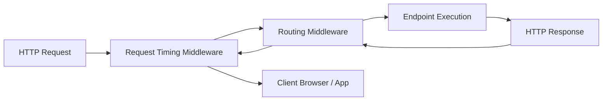

# Part 09: Building Web APIs with ASP.NET Core

Welcome to **Part 09** of the course. In this module, you will learn how to build production-grade RESTful APIs using ASP.NET Core, Minimal APIs, custom middleware, and OpenAPI specifications.

---

## 📚 What You Will Learn
1. **ASP.NET Core Architecture**:
   - The HTTP Request Pipeline: Middleware order, short-circuiting, and response generation.
   - Writing custom middleware (`RequestTimingMiddleware`).
2. **Minimal APIs**:
   - Route mapping (`app.MapGet`, `app.MapPost`, `app.MapPut`, `app.MapDelete`).
   - Grouping routes with `app.MapGroup("/api/courses")`.
   - Typed results (`TypedResults.Ok()`, `TypedResults.NotFound()`, `TypedResults.Created()`).
3. **Validation & Problem Details**:
   - Standardized RFC 7807 error responses for 400 Bad Request and 404 Not Found.
4. **OpenAPI Integration**:
   - Built-in OpenAPI metadata, route tags, summaries, and schema generation.

---

## 🧠 Core Theoretical Concepts

### 1. The ASP.NET Core Middleware Pipeline



### 2. Controller-Based vs Minimal APIs

| Feature | Controllers (`[ApiController]`) | Minimal APIs (`app.MapGet`) |
| :--- | :--- | :--- |
| **Boilerplate** | High (Inherits `ControllerBase`, separate class files, attributes) | Low (Concise lambda handlers or static extension methods) |
| **Startup Performance** | Slightly slower (reflection scan over assemblies) | Blazing fast (direct delegate mapping) |
| **Memory Footprint** | Heavier allocations per request | Minimal allocations, ideal for microservices & cloud-native |
| **Best Used For** | Massive legacy enterprise APIs with hundreds of actions | Modern greenfield APIs, microservices, serverless functions |

---

## 🚀 How to Run This Project

```bash
cd 09-aspnetcore-webapi
dotnet run
```

The server starts by default on `http://localhost:5000` (or the URL printed in console).

### Test with `curl`:
```bash
# Get all courses
curl http://localhost:5000/api/courses

# Get by ID
curl http://localhost:5000/api/courses/11111111-1111-1111-1111-111111111111

# Create a new course
curl -X POST http://localhost:5000/api/courses \
  -H "Content-Type: application/json" \
  -d '{"title":"Docker for .NET Developers","description":"Containerization guide","level":"Intermediate","price":29.99}'
```

Or open `api-tests.http` inside VS Code / Visual Studio / Rider to click and execute directly!

---

## 📝 Practice Exercises
1. Add an endpoint filter (`AddEndpointFilter`) that logs the user agent header and rejects requests missing an `Authorization` or `X-Api-Key` header.
2. Implement rate limiting using ASP.NET Core's built-in `Microsoft.AspNetCore.RateLimiting` middleware.
3. Add a pagination query parameter (`?page=1&pageSize=10`) with `X-Total-Count` response header.
