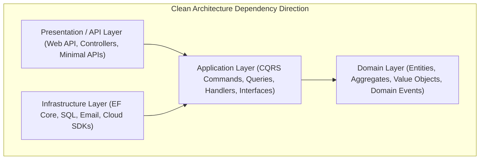

# Part 10: Clean Architecture & Enterprise Patterns

Welcome to **Part 10** of the course. In this module, you will learn how to architect large-scale, maintainable .NET solutions using Clean Architecture, Domain-Driven Design (DDD) aggregates, CQRS, and the Result pattern.

---

## 📚 What You Will Learn
1. **Clean Architecture Principles**:
   - The **Dependency Rule**: Inner layers have zero references to outer layers.
   - Separation of Domain, Application, Infrastructure, and Presentation.
2. **Domain-Driven Design (DDD) Basics**:
   - Aggregate Roots (`Wallet`), Invariants, and Business Rules.
   - **Domain Events** (`WalletCreditedEvent`, `WalletDebitedEvent`).
3. **CQRS (Command Query Responsibility Segregation)**:
   - Separating Write side (Commands mutate state) from Read side (Queries return pure DTOs).
4. **The Result Pattern (Railway-Oriented Programming)**:
   - Returning `Result<T>` instead of throwing exceptions for business logic control flow.

---

## 🧠 Core Theoretical Concepts

### 1. The Onion / Clean Architecture Layers



### 2. Exceptions vs Result<T> for Business Failures

| Aspect | Throwing Exceptions | `Result<T>` Pattern |
| :--- | :--- | :--- |
| **Performance** | Expensive (captures full stack trace, unwinds call stack) | Fast (zero stack trace capture, simple object return) |
| **Type Signature** | Hidden (calling code cannot tell what exceptions may occur) | Explicit (`Result<T>` compiler enforces handling) |
| **Intended Use** | Exceptional fatal conditions (Disk failure, DB crash, Out of memory) | Normal business validation (Insufficient funds, user not found) |

---

## 🚀 How to Run This Project

```bash
cd 10-clean-architecture-patterns
dotnet run
```

---

## 📝 Practice Exercises
1. Introduce a MediatR-style `IMediator` interface and register handlers in the DI container.
2. Add a `FreezeWalletCommand` that disables transactions on a wallet if suspected of fraud.
3. Implement a pipeline behavior for logging the execution time of every CQRS command.
