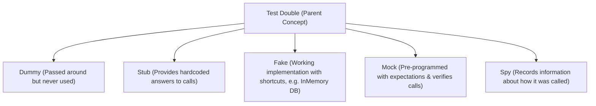

# Part 11: Unit Testing, Quality Assurance & Test Doubles

Welcome to **Part 11** of the course. In this final module, you will learn how to write robust, maintainable automated tests in C# using xUnit, follow the Arrange-Act-Assert (AAA) pattern, and test business logic with Test Doubles.

---

## 📚 What You Will Learn
1. **The Testing Pyramid**:
   - Unit Tests (Fast, isolated, testing individual functions and classes).
   - Integration Tests (Testing database interactions, HTTP endpoints).
   - End-to-End Tests (Full user journey).
2. **The xUnit Framework**:
   - `[Fact]` for single-condition tests.
   - `[Theory]` and `[InlineData]` for parameterized data-driven testing.
   - Assertions: `Assert.Equal`, `Assert.True`, `Assert.Throws`, `Assert.ThrowsAsync`.
3. **The AAA Pattern (Arrange - Act - Assert)**:
   - Setting up test prerequisites.
   - Invoking the System Under Test (SUT).
   - Verifying expected outcomes and invariants.
4. **Test Doubles (Mocks, Fakes, Stubs)**:
   - Isolating external dependencies (payment gateways, databases, third-party APIs).
   - Verifying side effects and contract enforcement.

---

## 🧠 Core Theoretical Concepts

### 1. The AAA Pattern Anatomy

```csharp
[Fact]
public void CalculateDiscount_PlatinumHighValue_ReturnsSuperDiscount()
{
    // 1. Arrange: Setup initial state & SUT (System Under Test)
    var calculator = new DiscountCalculator();
    decimal orderTotal = 600m;

    // 2. Act: Execute the method under test
    decimal result = calculator.CalculateDiscount(orderTotal, "Platinum");

    // 3. Assert: Validate the output meets expectations
    Assert.Equal(0.25m, result);
}
```

### 2. Test Double Taxonomy



---

## 🚀 How to Run This Project

Run the test suite using the .NET test runner:

```bash
cd 11-testing-and-quality
dotnet test
```

To see detailed test output per test case:
```bash
dotnet test --logger "console;verbosity=detailed"
```

---

## 📝 Practice Exercises
1. Add tests for edge cases in `DiscountCalculator` when `totalAmount` is exactly 0.
2. Use `Moq` or `NSubstitute` by adding package `dotnet add package NSubstitute` and rewrite `OrderCheckoutServiceTests` using auto-mocking syntax (`Substitute.For<IPaymentGateway>()`).
3. Add a test verifying that `IInventoryService.ReserveStockAsync` is called with the exact product ID and quantity passed to `CheckoutAsync`.
