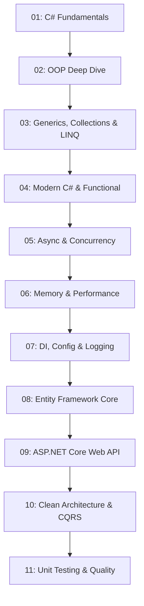

# 🚀 Complete .NET & C# Mastery: From Zero to Hero

Welcome to the **Complete .NET Programming Course** — an end-to-end, hands-on, enterprise-grade curriculum designed to take you from absolute zero to an advanced .NET engineer.

Every module is organized into its own self-contained folder with:
- 📖 An in-depth **`README.md`** explaining core theory, architecture diagrams, memory mechanics, and interview questions.
- 💻 **Complete, runnable C# source code** ready to execute immediately with `dotnet run` or `dotnet test`.

---

## 🗺️ Curriculum Roadmap



---

## 📂 Course Modules Overview

| Part | Directory | Topics Covered | Run Command |
| :---: | :--- | :--- | :--- |
| **01** | [01-csharp-fundamentals](./01-csharp-fundamentals) | Stack vs Heap, Value vs Reference types, Null safety (`?`, `??`, `??=`), Modern Pattern Matching switches, Parameter modifiers (`out`, `ref`, `params`) | `dotnet run --project 01-csharp-fundamentals` |
| **02** | [02-oop-deep-dive](./02-oop-deep-dive) | 4 Pillars of OOP, `init`/`required` properties, Default Interface Methods (DIM), Explicit Interface Implementation, Class vs Struct vs Record with `with` mutation | `dotnet run --project 02-oop-deep-dive` |
| **03** | [03-generics-collections-linq](./03-generics-collections-linq) | Generic type constraints, Boxing prevention, `PriorityQueue`, `HashSet`, LINQ Deferred vs Immediate execution, `GroupBy`, `SelectMany`, `Join` | `dotnet run --project 03-generics-collections-linq` |
| **04** | [04-modern-csharp-features](./04-modern-csharp-features) | `Func<T>`, `Action<T>`, Closures, Events & EventHandlers, C# 11+ List patterns (`[first, .., last]`), Property patterns, Fluent Extension methods | `dotnet run --project 04-modern-csharp-features` |
| **05** | [05-async-and-threading](./05-async-and-threading) | `Task.WhenAll`, `ValueTask<T>` allocation optimization, `CancellationToken` timeouts, Concurrency throttling with `SemaphoreSlim`, Lock-free `Interlocked`, `IAsyncEnumerable<T>` | `dotnet run --project 05-async-and-threading` |
| **06** | [06-memory-and-performance](./06-memory-and-performance) | Garbage Collection (Gen 0, 1, 2, LOH, POH), `IDisposable` pattern, Zero-allocation string parsing with `ReadOnlySpan<char>`, `ArrayPool<T>`, `stackalloc` | `dotnet run --project 06-memory-and-performance` |
| **07** | [07-di-configuration-logging](./07-di-configuration-logging) | .NET Generic Host (`HostApplicationBuilder`), Service Lifetimes (`Transient`, `Scoped`, `Singleton`), Captive Dependencies, Strongly-typed `IOptions<T>`, Structured `ILogger` | `dotnet run --project 07-di-configuration-logging` |
| **08** | [08-entity-framework-core](./08-entity-framework-core) | SQLite ORM, Code-First Fluent API, 1-to-N and N-to-N relationships, Eager loading (`Include`) preventing N+1 problems, Projections, Change Tracker | `dotnet run --project 08-entity-framework-core` |
| **09** | [09-aspnetcore-webapi](./09-aspnetcore-webapi) | Minimal APIs, Request pipeline middleware (`RequestTimingMiddleware`), Route grouping, `TypedResults`, RFC 7807 Problem Details, OpenAPI, `.http` test suite | `dotnet run --project 09-aspnetcore-webapi` |
| **10** | [10-clean-architecture-patterns](./10-clean-architecture-patterns) | Onion / Clean Architecture, DDD Aggregate Roots (`Wallet`), Invariants, Domain Events, CQRS Commands & Queries, Railway-Oriented `Result<T>` error handling | `dotnet run --project 10-clean-architecture-patterns` |
| **11** | [11-testing-and-quality](./11-testing-and-quality) | xUnit testing framework, AAA Pattern (Arrange-Act-Assert), `[Fact]` & `[Theory]` data-driven testing, Exception assertions, Test Doubles (Mocks/Fakes) | `dotnet test` |

---

## ⚡ Quick Start

### 1. Prerequisites
Ensure you have the .NET SDK installed (works seamlessly on .NET 8, 9, or 10):
```bash
dotnet --version
```

### 2. Build the Entire Solution
All 11 projects are wired together in the master solution:
```bash
dotnet build DotNetCourse.sln
```

### 3. Run Any Part Individually
You can run any part directly from the root:
```bash
# Example: Run Part 01 C# Fundamentals
dotnet run --project 01-csharp-fundamentals

# Example: Run Part 08 EF Core SQLite Demo
dotnet run --project 08-entity-framework-core

# Example: Run Part 10 Clean Architecture CQRS Demo
dotnet run --project 10-clean-architecture-patterns

# Example: Run Part 11 Automated Test Suite
dotnet test
```

---

## 🎓 Recommended Learning Order

1. **Foundations (Weeks 1-2)**: Work through **Parts 01 - 04** to achieve fluency in modern C# syntax, type systems, and LINQ.
2. **Runtime & Systems (Weeks 3-4)**: Master **Parts 05 - 07** to understand non-blocking async, memory management, zero-allocation Span slicing, and Dependency Injection.
3. **Data & APIs (Weeks 5-6)**: Build database applications in **Part 08** and production web APIs in **Part 09**.
4. **Enterprise Architecture & Testing (Weeks 7-8)**: Master domain modeling, CQRS, and unit testing in **Parts 10 - 11**.

Happy coding! 🎉
